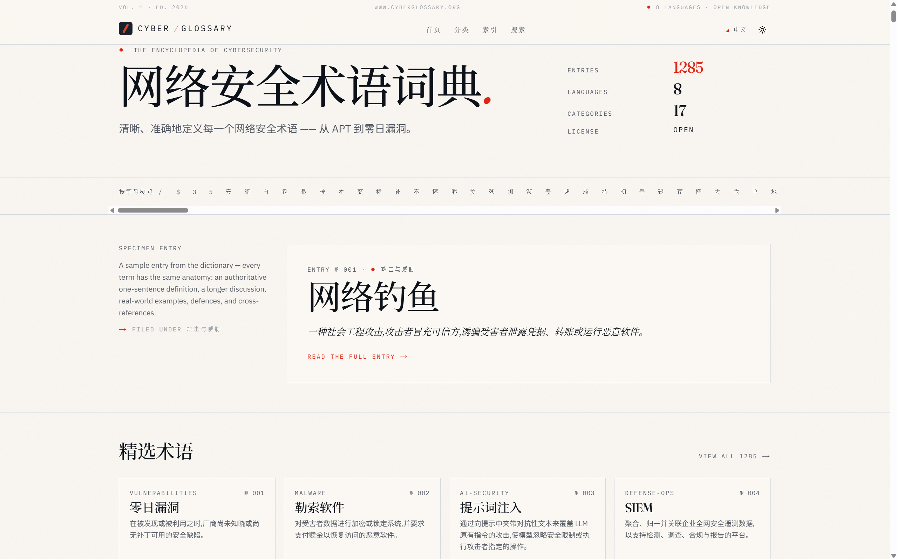
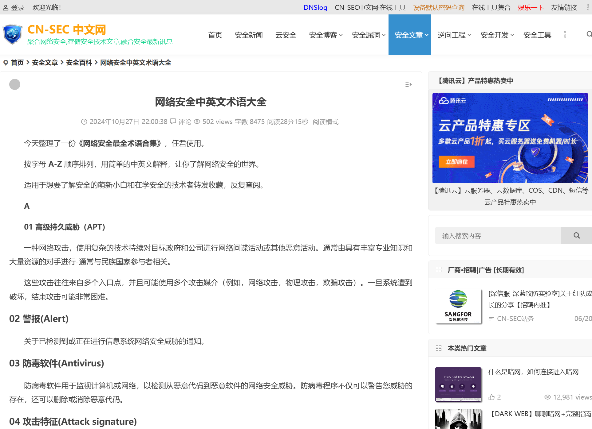

# 🛡️ 网络安全专业名词大全 — 资源汇总

> 全网深度检索 | 更新日期：2026-07-21
> 涵盖：中文术语库 / 英文权威库 / 缩略词速查 / 知识框架 / 国家标准 / 漏洞分类 / 攻防知识库

---

## 目录

- [一、中文术语大全（最推荐，共 12 个）](#一中文术语大全最推荐共-12-个)
- [二、英文权威术语库（国际标准，共 10 个）](#二英文权威术语库国际标准共-10-个)
- [三、缩略词速查（攻防场景高频，共 5 个）](#三缩略词速查攻防场景高频共-5-个)
- [四、安全知识框架与标准体系（共 8 个）](#四安全知识框架与标准体系共-8-个)
- [五、中英文对照词典（共 6 个）](#五中英文对照词典共-6-个)
- [六、漏洞分类与攻击模式库（共 5 个）](#六漏洞分类与攻击模式库共-5-个)
- [七、Web 安全知识库（共 3 个）](#七web-安全知识库共-3-个)
- [八、国家标准（GB 系列，共 5 个）](#八国家标准gb-系列共-5-个)
- [九、安全认证与专业英语（共 4 个）](#九安全认证与专业英语共-4-个)
- [十、学习路径推荐](#十学习路径推荐)

---

## 一、中文术语大全（最推荐，共 12 个）

| # | 资源名称 | 链接 | 特点 | 图片 |
|---|---------|------|------|------|
| 1 | **CyberGlossary 中文版** 🥇 | https://www.cyberglossary.org/zh | 分类清晰（攻击/威胁/密码学/网络/云安全等），附 CVE 案例，更新及时 |  |
| 2 | **CN-SEC 中英文术语大全** | https://cn-sec.com/archives/3320996.html | A-Z 字母排序，中英对照，系统全面 |  |
| 3 | **CSDN 网络安全黑话指南** | https://blog.csdn.net/shuryuu/article/details/121212187 | 最全详解，含攻击工具/方法/防守技术/软硬件，入门必看 |  |
| 4 | **FreeBuf 专业术语解释** | https://m.freebuf.com/articles/network/243201.html | APT/XSS/DoS 等概念详细解释，适合进阶 |  |
| 5 | **CN-SEC 安全科普词条** | https://cn-sec.com/archives/886666.html | 含 POC/EXP/Shellcode/0Day/1Day/NDay 等核心概念 |  |
| 6 | **腾讯云渗透测试名词** | https://cloud.tencent.com/developer/article/2580321 | 攻防双方名词全覆盖，含攻击载荷/漏洞/Shellcode 等 |  |
| 7 | **盾灵导航中英文对照表** | https://www.dunling.com/24472.html | 分类清晰（基础/攻击/防御/密码/认证），实用 |  |
| 8 | **2026 版 30 个核心术语** | https://www.gm7.org/archives/33597 | 2026 年最新版，含肉鸡/勒索/EDR/零信任/AI 安全等 |  |
| 9 | **笨熊呆呆瓜 核心术语体系** | https://www.bxddg.com/archives/anquanhexishuyu | 结构化体系，从漏洞到渗透到防御到 APT 全链路 |  |
| 10 | **阿里云 100 个中英文术语** | https://developer.aliyun.com/article/1632458 | 100 个术语详解，含认证/密码学/渗透测试等 |  |
| 11 | **安厦科技 最全术语汇总** | http://www.isa-hsse.com/index.php?a=show&catid=192&id=53471 | 中英文对照，含 CISA/CISM/CISSP 认证术语 |  |
| 12 | **Fortinet 20 种攻击类型** | https://www.fortinet.com/cn/resources/cyberglossary/types-of-cyber-attacks | 20 种常见攻击类型详解，含防御建议 |  |

---

## 二、英文权威术语库（国际标准，共 10 个）

| # | 资源名称 | 链接 | 特点 |
|---|---------|------|------|
| 1 | **NIST 网络安全术语表** 🥇 | https://csrc.nist.gov/glossary | **10,113 条**，美国国家标准与技术研究院，更新至 2026-05-29 |
| 2 | **CISA/NICCS 术语表** | https://niccs.cisa.gov/resources/glossary | 美国政府官方，支持 CSV 下载 |
| 3 | **NIST IR 7298 Rev.3 术语表** | https://nvlpubs.nist.gov/nistpubs/ir/2019/NIST.IR.7298r3.pdf | 官方 PDF，从 NIST FIPS/SP 系列提取的权威术语 |
| 4 | **SANS 安全术语表** | https://www.sans.org/security-resources/glossary-of-terms | 按 A-Z 分组，全球最权威安全培训机构 |
| 5 | **CyberGlossary 英文版** | https://www.cyberglossary.org/en | 分类浏览 + 全部术语列表，交互友好 |
| 6 | **SecurityElites 1506 条** | https://securityelites.com/glossary/ | **1506 条**，按应用/云/密码学等 24 类分类 |
| 7 | **Coursera 网络安全术语** | https://www.coursera.org/resources/cybersecurity-terms | 适合初学者，更新至 2025-08 |
| 8 | **CyberExperts 百科** | https://cyberexperts.com/encyclopedia/ | **870 条**，聚焦风险管理与合规 |
| 9 | **Cybersecurity Terms Lexicon** | https://cybersecuritytermslexicon.com/ | 注重概念关联，非简单词条罗列 |
| 10 | **Fortinet 网络安全词汇表** | https://www.fortinet.com/cn/resources/cyberglossary | 厂商出品，含中文版，更新频繁 |

---

## 三、缩略词速查（攻防场景高频，共 5 个）

| # | 资源名称 | 链接 | 特点 |
|---|---------|------|------|
| 1 | **信息安全缩略词表** 🥇 | https://github.com/truckli/infosec-abbrv | **4732 条缩略词**，涵盖攻防/运营/研发/ICT/AI，GitHub 开源 |
| 2 | **DecodeIT 安全术语 2025** | https://decodeit.app/zh-cn/security/guides/security-glossary | 含 AI 威胁、后量子密码学、无密码认证等最新趋势 |
| 3 | **Cybyr Cyberpedia** | https://cybyr.com/cyberpedia/ | 更新至 2026-06，含术语/缩略词/威胁/防御四维 |
| 4 | **NIST IR7581 缩略词** | https://nvlpubs.nist.gov/nistpubs/Legacy/IR/nistir7581.pdf | 约 1000 个网络安全缩略词，PDF 下载 |
| 5 | **All Acronyms 网站** | https://www.allacronyms.com/ | 社区驱动通用缩略词数据库，词条数庞大 |

---

## 四、安全知识框架与标准体系（共 8 个）

| # | 资源名称 | 链接 | 特点 |
|---|---------|------|------|
| 1 | **MITRE ATT&CK 中文版** 🥇 | https://www.xiasec.com/wp-content/Attack_CN/ | 全球最权威的对抗战术与技术知识库，含中文翻译 |
| 2 | **MITRE ATT&CK 英文版** | https://attack.mitre.org/ | 原版，覆盖 14 个战术阶段，数百种技术 |
| 3 | **CWE 通用弱点枚举 v4.20** | https://cwe.mitre.org/data/ | **944 种**软硬件弱点类型，含 CWE Top 25 (2025) |
| 4 | **CWE 中文版 v4.20** | https://cwe.org.cn/data/index.html | CWE 中文镜像站，含 944 条完整弱点列表 |
| 5 | **CAPEC 通用攻击模式枚举** | https://capec.mitre.org/ | 攻击模式字典，与 CWE/ATT&CK 交叉关联 |
| 6 | **CAPEC 词汇表** | https://capec.mitre.org/about/glossary.html | 攻击模式相关术语定义 |
| 7 | **OWASP Top 10** | https://owasp.org/www-project-top-ten/ | Web 应用安全十大风险，国际标准 |
| 8 | **NIST 网络安全框架 CSF 2.0** | https://www.nist.gov/cyberframework | 美国网络安全框架，Govern/Identify/Protect/Detect/Respond/Recover |

---

## 五、中英文对照词典（共 6 个）

| # | 资源名称 | 链接 | 特点 |
|---|---------|------|------|
| 1 | **盾灵导航 中英文对照表** | https://www.dunling.com/24472.html | 分类清晰，含基础/攻击/防御/密码/认证/工具 |
| 2 | **阿里云 100 个中英文术语** | https://developer.aliyun.com/article/1632458 | 100 个高频术语，中英文对照详解 |
| 3 | **孤独剑客 中英文对照** | https://www.janker.org/tech/18.html | 简洁对照表，适合快速查阅 |
| 4 | **ISACA 中英文术语表** | https://www.isaca.org/-/media/files/isacadp/project/isaca/resources/glossary/isaca-glossary-english-chinese-simplified_mis_chi_0615.pdf | ISACA 官方中英文对照，含审计/治理/安全 |
| 5 | **香港政府 IT 术语中英对照** | https://www.digitalpolicy.gov.hk/tc/our_work/digital_infrastructure/methodology/glossary/doc/IT_Glossary.pdf | 香港政府官方 IT 中英对照，含大量安全术语 |
| 6 | **Security Glossary TW 繁体中文** | https://github.com/astroicers/security-glossary-tw | 台湾开源繁体中文术语库，含 YAML/JSON/API |

---

## 六、漏洞分类与攻击模式库（共 5 个）

| # | 资源名称 | 链接 | 特点 |
|---|---------|------|------|
| 1 | **CVE 公共漏洞与暴露** | https://cve.mitre.org/ | 全球漏洞编号标准，CVE-YYYY-NNNNN 格式 |
| 2 | **NVD 美国国家漏洞数据库** | https://nvd.nist.gov/ | 含 CVSS 评分、影响评估、修复信息 |
| 3 | **CNVD 国家漏洞数据库** | https://www.cnvd.org.cn/ | 中国国家漏洞数据库，含中文描述 |
| 4 | **CNNVD 中国国家漏洞库** | http://www.cnnvd.org.cn/ | 中国信息安全测评中心维护 |
| 5 | **Vulhub 漏洞复现环境** | https://github.com/vulhub/vulhub | Docker 一键搭建漏洞环境，含 CVE-2024-27198 等 |

---

## 七、Web 安全知识库（共 3 个）

| # | 资源名称 | 链接 | 特点 |
|---|---------|------|------|
| 1 | **Web 安全学习笔记** 🥇 | https://websec.readthedocs.io/zh/latest/index.html | 完整 Web 安全知识体系，含 SQL/XSS/CSRF/SSRF/RCE 等 + 防御技术 + 工具 |
| 2 | **Web 安全术语页** | https://websec.readthedocs.io/zh/latest/misc/terminology.html | 常见术语集中解释 |
| 3 | **OWASP 官方文档** | https://owasp.org/ | Web 应用安全国际权威组织 |

---

## 八、国家标准（GB 系列，共 5 个）

| # | 标准号 | 名称 | 链接 | 特点 |
|---|-------|------|------|------|
| 1 | **GB/T 25069-2022** | 信息安全技术 术语 | https://www.bzchaxun.com/view/8030070010000000.html | **最权威国家标准**，176 页，替代 2010 版 |
| 2 | **GB/T 30279-2020** | 网络安全漏洞分类分级指南 | https://ndls.cnis.ac.cn/standard/detail/ca2cbe3e899d9d0c8c294300320f72fc | 漏洞分类分级方法论 |
| 3 | **GB/T 22239-2019** | 网络安全等级保护基本要求 | 等保 2.0 核心标准 | 等级保护制度基础 |
| 4 | **GB/T 25070-2019** | 网络安全等级保护安全设计技术要求 | 等保 2.0 配套 | 安全设计要求 |
| 5 | **GB/T 28448-2019** | 网络安全等级保护测评要求 | 等保 2.0 配套 | 测评方法标准 |

---

## 九、安全认证与专业英语（共 4 个）

| # | 资源名称 | 链接 | 特点 |
|---|---------|------|------|
| 1 | **ISACA 中英文术语表** | https://www.isaca.org/-/media/files/isacadp/project/isaca/resources/glossary/isaca-glossary-english-chinese-simplified_mis_chi_0615.pdf | CISA/CISM/CGEIT 等认证术语 |
| 2 | **ISC² 术语表** | https://www.isc2.org/ | CISSP 认证相关术语 |
| 3 | **香港 IT 术语中英对照** | https://www.digitalpolicy.gov.hk/tc/our_work/digital_infrastructure/methodology/glossary/doc/IT_Glossary.pdf | 大量安全相关中英对照 |
| 4 | **Security Glossary TW** | https://github.com/astroicers/security-glossary-tw | 开源结构化工具体系，支持 API 调用 |

---

## 十、学习路径推荐

### 🟢 入门级（夏令营同学）

```
Step 1: CSDN 黑话指南           → 了解"肉鸡/挂马/提权/免杀"等行话
Step 2: CN-SEC 中英文术语大全    → 建立完整知识框架
Step 3: 阿里云 100 个术语        → 掌握高频核心术语
Step 4: GitHub 缩略词表         → 解决日常遇到的不明缩写
```

### 🟡 进阶级（安全从业者）

```
Step 1: MITRE ATT&CK 中文版      → 理解攻击者全生命周期
Step 2: CWE 弱点枚举             → 掌握漏洞本质分类
Step 3: NIST 网络安全术语表      → 权威定义，写报告引用
Step 4: GB/T 25069-2022 国标    → 国内标准权威参考
Step 5: Web 安全学习笔记         → 完整 Web 安全知识体系
```

### 🔴 专家级（安全研究员）

```
Step 1: CAPEC 攻击模式库         → 理解攻击模式与防御
Step 2: NVD / CVE 数据库        → 跟踪最新漏洞
Step 3: NIST CSF 2.0            → 企业安全治理框架
Step 4: SecurityElites 1506 条  → 深度专业术语
Step 5: MITRE ATT&CK 英文原版   → 国际最新战术技术
```

---

## 附录：快速查找表

### 常见安全缩略词速查

| 缩略词 | 英文全称 | 中文全称 |
|--------|---------|---------|
| APT | Advanced Persistent Threat | 高级持续性威胁 |
| CVE | Common Vulnerabilities and Exposures | 公共漏洞与暴露 |
| CWE | Common Weakness Enumeration | 通用弱点枚举 |
| CAPEC | Common Attack Pattern Enumeration and Classification | 通用攻击模式枚举 |
| CVSS | Common Vulnerability Scoring System | 通用漏洞评分系统 |
| OWASP | Open Web Application Security Project | 开放式 Web 应用安全项目 |
| SIEM | Security Information and Event Management | 安全信息与事件管理 |
| EDR | Endpoint Detection and Response | 端点检测与响应 |
| XDR | Extended Detection and Response | 扩展检测与响应 |
| SOAR | Security Orchestration, Automation and Response | 安全编排自动化与响应 |
| WAF | Web Application Firewall | Web 应用防火墙 |
| IDS | Intrusion Detection System | 入侵检测系统 |
| IPS | Intrusion Prevention System | 入侵防御系统 |
| MFA | Multi-Factor Authentication | 多因素认证 |
| IAM | Identity and Access Management | 身份与访问管理 |
| PAM | Privileged Access Management | 特权访问管理 |
| SOC | Security Operations Center | 安全运营中心 |
| NGFW | Next-Generation Firewall | 下一代防火墙 |
| DDoS | Distributed Denial of Service | 分布式拒绝服务 |
| RCE | Remote Code Execution | 远程代码执行 |
| XSS | Cross-Site Scripting | 跨站脚本攻击 |
| CSRF | Cross-Site Request Forgery | 跨站请求伪造 |
| SSRF | Server-Side Request Forgery | 服务端请求伪造 |
| SQLi | SQL Injection | SQL 注入 |
| XXE | XML External Entity | XML 外部实体注入 |
| MITM | Man-in-the-Middle | 中间人攻击 |
| PoC | Proof of Concept | 概念验证 |
| CVE | Common Vulnerabilities and Exposures | 公共漏洞与暴露 |

---

> 📌 **说明**：以上资源均来自互联网公开可访问的链接，建议收藏常用链接。部分资源可能需科学上网访问。所有链接最后验证日期为 2026-07-21。
>
> 💡 **建议**：将此文档加入飞书知识库或团队文档，方便夏令营同学随时查阅。