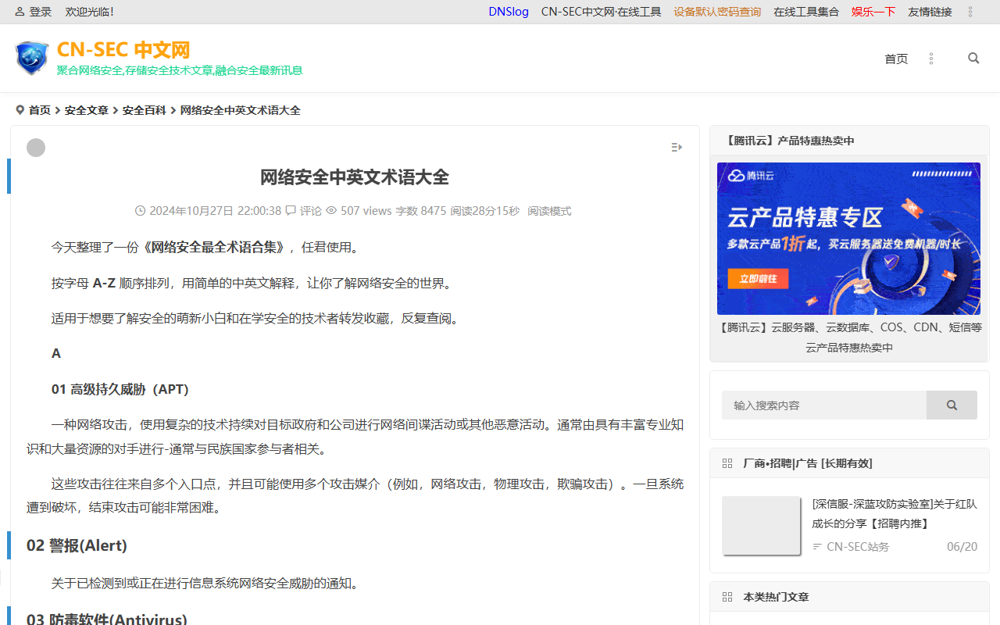
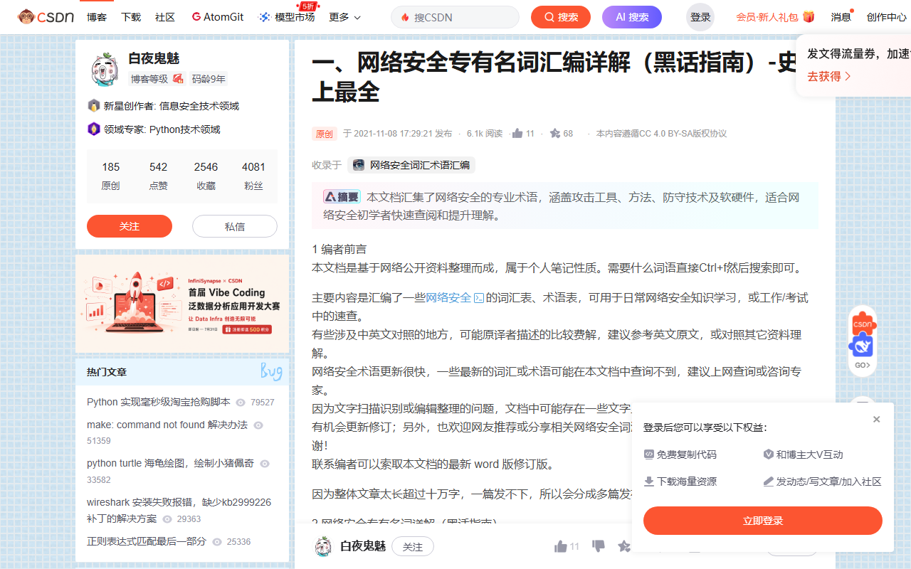
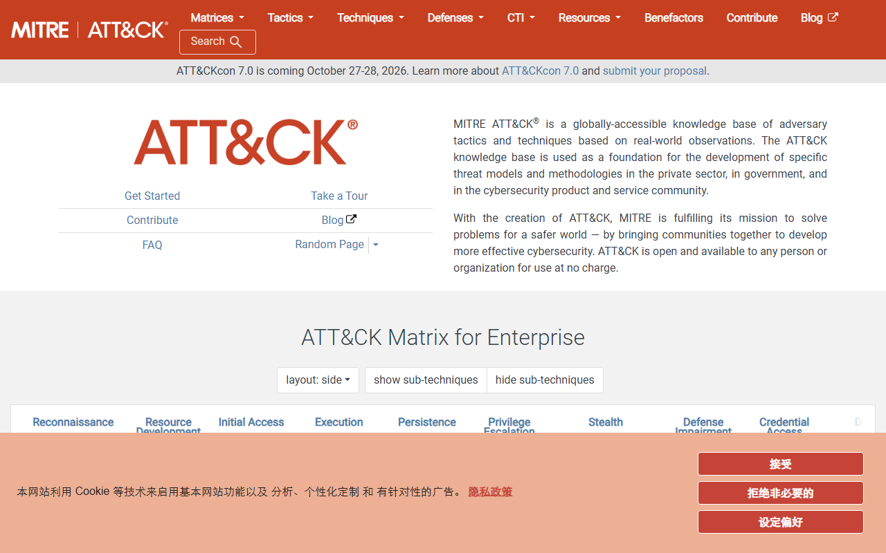
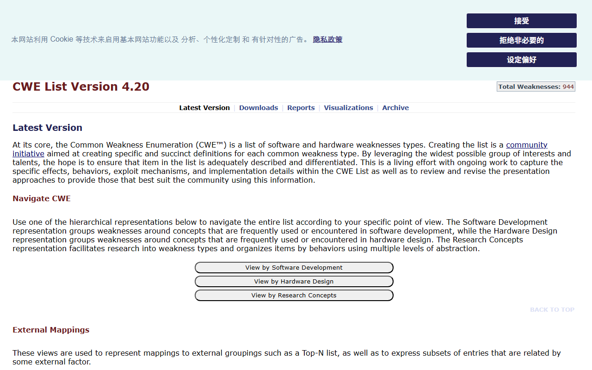
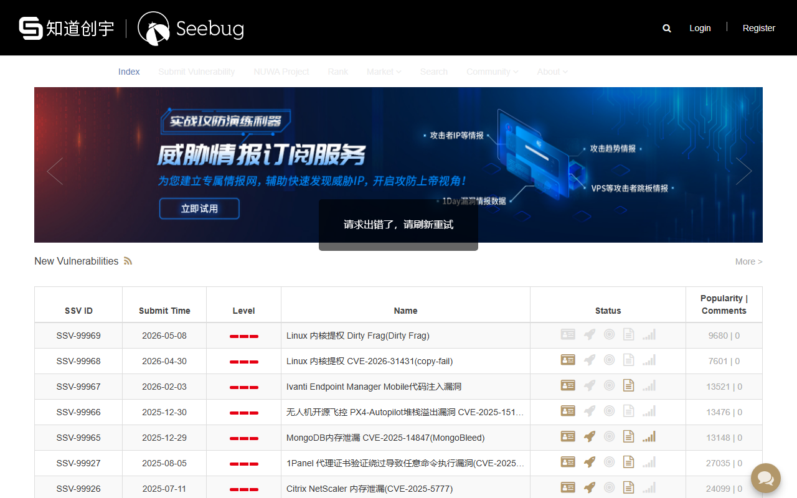
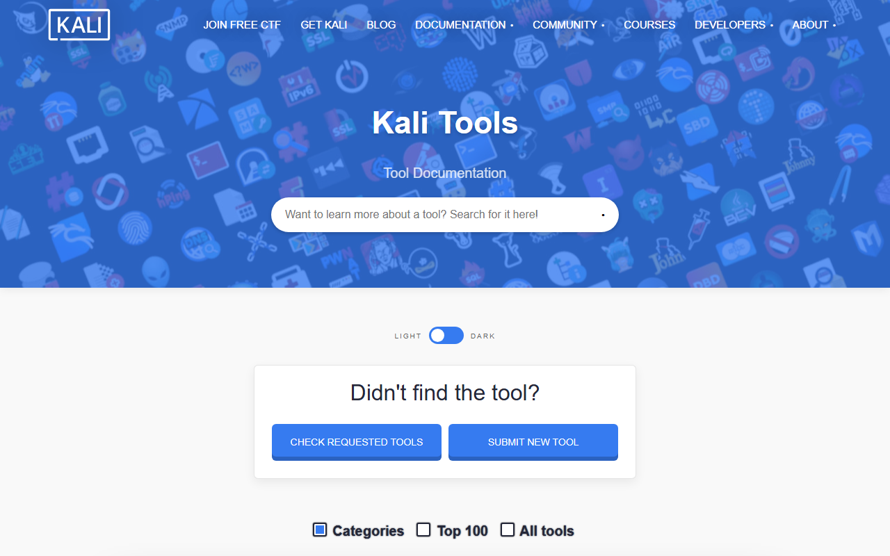
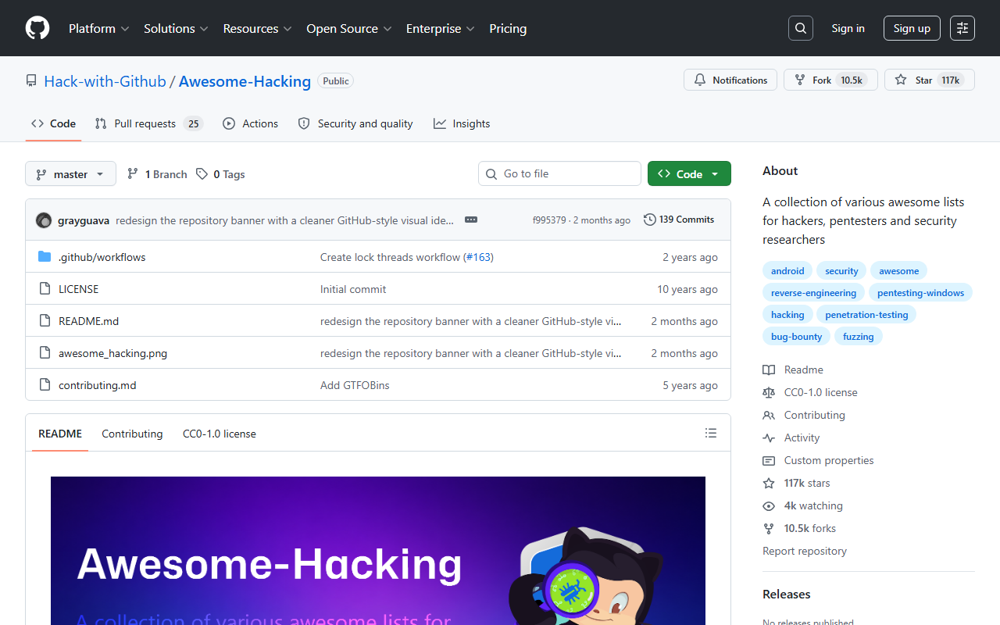

# 🛡️ 网络安全专业名词大全 — 资源汇总

> 全网深度检索 | 更新日期：2026-07-21
> 涵盖：中文术语库 / 英文权威库 / 缩略词速查 / 知识框架 / 国家标准 / 漏洞分类 / 攻防知识库

---

## 目录

- [一、中文术语大全（最推荐，共 12 个）](#一中文术语大全最推荐共-12-个)
- [二、英文权威术语库（国际标准，共 10 个）](#二英文权威术语库国际标准共-10-个)
- [三、缩略词速查（攻防场景高频，共 5 个）](#三缩略词速查攻防场景高频共-5-个)
- [四、安全知识框架与标准体系（共 8 个）](#四安全知识框架与标准体系共-8-个)
- [五、中英文对照词典（共 6 个）](#五中英文对照词典共-6-个)
- [六、漏洞分类与攻击模式库（共 5 个）](#六漏洞分类与攻击模式库共-5-个)
- [七、Web 安全知识库（共 3 个）](#七web-安全知识库共-3-个)
- [八、国家标准（GB 系列，共 5 个）](#八国家标准gb-系列共-5-个)
- [九、安全认证与专业英语（共 4 个）](#九安全认证与专业英语共-4-个)
- [十、学习路径推荐](#十学习路径推荐)

---

## 一、中文术语大全（最推荐，共 12 个）

| # | 资源名称 | 链接 | 特点 |
|---|---------|------|------|
| 1 | **CyberGlossary 中文版** 🥇 | https://www.cyberglossary.org/zh | 分类清晰（攻击/威胁/密码学/网络/云安全等），附 CVE 案例，更新及时 |
| 2 | **CN-SEC 中英文术语大全** | https://cn-sec.com/archives/3320996.html | A-Z 字母排序，中英对照，系统全面 |
| 3 | **CSDN 网络安全黑话指南** | https://blog.csdn.net/shuryuu/article/details/121212187 | 最全详解，含攻击工具/方法/防守技术/软硬件，入门必看 |
| 4 | **FreeBuf 专业术语解释** | https://m.freebuf.com/articles/network/243201.html | APT/XSS/DoS 等概念详细解释，适合进阶 |
| 5 | **CN-SEC 安全科普词条** | https://cn-sec.com/archives/886666.html | 含 POC/EXP/Shellcode/0Day/1Day/NDay 等核心概念 |
| 6 | **腾讯云渗透测试名词** | https://cloud.tencent.com/developer/article/2580321 | 攻防双方名词全覆盖，含攻击载荷/漏洞/Shellcode 等 |
| 7 | **盾灵导航中英文对照表** | https://www.dunling.com/24472.html | 分类清晰（基础/攻击/防御/密码/认证），实用 |
| 8 | **2026 版 30 个核心术语** | https://www.gm7.org/archives/33597 | 2026 年最新版，含肉鸡/勒索/EDR/零信任/AI 安全等 |
| 9 | **笨熊呆呆瓜 核心术语体系** | https://www.bxddg.com/archives/anquanhexishuyu | 结构化体系，从漏洞到渗透到防御到 APT 全链路 |
| 10 | **阿里云 100 个中英文术语** | https://developer.aliyun.com/article/1632458 | 100 个术语详解，含认证/密码学/渗透测试等 |
| 11 | **安厦科技 最全术语汇总** | http://www.isa-hsse.com/index.php?a=show&catid=192&id=53471 | 中英文对照，含 CISA/CISM/CISSP 认证术语 |
| 12 | **Fortinet 20 种攻击类型** | https://www.fortinet.com/cn/resources/cyberglossary/types-of-cyber-attacks | 20 种常见攻击类型详解，含防御建议 |

### 📸 网站截图预览

<p align="center">
  
  
</p>

---

## 二、英文权威术语库（国际标准，共 10 个）

| # | 资源名称 | 链接 | 特点 |
|---|---------|------|------|
| 1 | **NIST 网络安全术语表** 🥇 | https://csrc.nist.gov/glossary | **10,113 条**，美国国家标准与技术研究院，更新至 2026-05-29 |
| 2 | **CISA/NICCS 术语表** | https://niccs.cisa.gov/resources/glossary | 美国政府官方，支持 CSV 下载 |
| 3 | **NIST IR 7298 Rev.3 术语表** | https://nvlpubs.nist.gov/nistpubs/ir/2019/NIST.IR.7298r3.pdf | 官方 PDF，从 NIST FIPS/SP 系列提取的权威术语 |
| 4 | **SANS 安全术语表** | https://www.sans.org/security-resources/glossary-of-terms | 按 A-Z 分组，全球最权威安全培训机构 |
| 5 | **CyberGlossary 英文版** | https://www.cyberglossary.org/en | 分类浏览 + 全部术语列表，交互友好 |
| 6 | **SecurityElites 1506 条** | https://securityelites.com/glossary/ | **1506 条**，按应用/云/密码学等 24 类分类 |
| 7 | **Coursera 网络安全术语** | https://www.coursera.org/resources/cybersecurity-terms | 适合初学者，更新至 2025-08 |
| 8 | **CyberExperts 百科** | https://cyberexperts.com/encyclopedia/ | **870 条**，聚焦风险管理与合规 |
| 9 | **Cybersecurity Terms Lexicon** | https://cybersecuritytermslexicon.com/ | 注重概念关联，非简单词条罗列 |
| 10 | **Fortinet 网络安全词汇表** | https://www.fortinet.com/cn/resources/cyberglossary | 厂商出品，含中文版，更新频繁 |

---

## 三、缩略词速查（攻防场景高频，共 5 个）

| # | 资源名称 | 链接 | 特点 |
|---|---------|------|------|
| 1 | **信息安全缩略词表** 🥇 | https://github.com/truckli/infosec-abbrv | **4732 条缩略词**，涵盖攻防/运营/研发/ICT/AI，GitHub 开源 |
| 2 | **DecodeIT 安全术语 2025** | https://decodeit.app/zh-cn/security/guides/security-glossary | 含 AI 威胁、后量子密码学、无密码认证等最新趋势 |
| 3 | **Cybyr Cyberpedia** | https://cybyr.com/cyberpedia/ | 更新至 2026-06，含术语/缩略词/威胁/防御四维 |
| 4 | **NIST IR7581 缩略词** | https://nvlpubs.nist.gov/nistpubs/Legacy/IR/nistir7581.pdf | 约 1000 个网络安全缩略词，PDF 下载 |
| 5 | **All Acronyms 网站** | https://www.allacronyms.com/ | 社区驱动通用缩略词数据库，词条数庞大 |

---

## 四、安全知识框架与标准体系（共 8 个）

| # | 资源名称 | 链接 | 特点 |
|---|---------|------|------|
| 1 | **MITRE ATT&CK 中文版** 🥇 | https://www.xiasec.com/wp-content/Attack_CN/ | 全球最权威的对抗战术与技术知识库，含中文翻译 |
| 2 | **MITRE ATT&CK 英文版** | https://attack.mitre.org/ | 原版，覆盖 14 个战术阶段，数百种技术 |
| 3 | **CWE 通用弱点枚举 v4.20** | https://cwe.mitre.org/data/ | **944 种**软硬件弱点类型，含 CWE Top 25 (2025) |
| 4 | **CWE 中文版 v4.20** | https://cwe.org.cn/data/index.html | CWE 中文镜像站，含 944 条完整弱点列表 |
| 5 | **CAPEC 通用攻击模式枚举** | https://capec.mitre.org/ | 攻击模式字典，与 CWE/ATT&CK 交叉关联 |
| 6 | **CAPEC 词汇表** | https://capec.mitre.org/about/glossary.html | 攻击模式相关术语定义 |
| 7 | **OWASP Top 10** | https://owasp.org/www-project-top-ten/ | Web 应用安全十大风险，国际标准 |
| 8 | **NIST 网络安全框架 CSF 2.0** | https://www.nist.gov/cyberframework | 美国网络安全框架，Govern/Identify/Protect/Detect/Respond/Recover |

---

## 五、中英文对照词典（共 6 个）

| # | 资源名称 | 链接 | 特点 |
|---|---------|------|------|
| 1 | **盾灵导航 中英文对照表** | https://www.dunling.com/24472.html | 分类清晰，含基础/攻击/防御/密码/认证/工具 |
| 2 | **阿里云 100 个中英文术语** | https://developer.aliyun.com/article/1632458 | 100 个高频术语，中英文对照详解 |
| 3 | **孤独剑客 中英文对照** | https://www.janker.org/tech/18.html | 简洁对照表，适合快速查阅 |
| 4 | **ISACA 中英文术语表** | https://www.isaca.org/-/media/files/isacadp/project/isaca/resources/glossary/isaca-glossary-english-chinese-simplified_mis_chi_0615.pdf | ISACA 官方中英文对照，含审计/治理/安全 |
| 5 | **香港政府 IT 术语中英对照** | https://www.digitalpolicy.gov.hk/tc/our_work/digital_infrastructure/methodology/glossary/doc/IT_Glossary.pdf | 香港政府官方 IT 中英对照，含大量安全术语 |
| 6 | **Security Glossary TW 繁体中文** | https://github.com/astroicers/security-glossary-tw | 台湾开源繁体中文术语库，含 YAML/JSON/API |

---

## 六、漏洞分类与攻击模式库（共 5 个）

| # | 资源名称 | 链接 | 特点 |
|---|---------|------|------|
| 1 | **CVE 公共漏洞与暴露** | https://cve.mitre.org/ | 全球漏洞编号标准，CVE-YYYY-NNNNN 格式 |
| 2 | **NVD 美国国家漏洞数据库** | https://nvd.nist.gov/ | 含 CVSS 评分、影响评估、修复信息 |
| 3 | **CNVD 国家漏洞数据库** | https://www.cnvd.org.cn/ | 中国国家漏洞数据库，含中文描述 |
| 4 | **CNNVD 中国国家漏洞库** | http://www.cnnvd.org.cn/ | 中国信息安全测评中心维护 |
| 5 | **Vulhub 漏洞复现环境** | https://github.com/vulhub/vulhub | Docker 一键搭建漏洞环境，含 CVE-2024-27198 等 |

---

## 七、Web 安全知识库（共 3 个）

| # | 资源名称 | 链接 | 特点 |
|---|---------|------|------|
| 1 | **Web 安全学习笔记** 🥇 | https://websec.readthedocs.io/zh/latest/index.html | 完整 Web 安全知识体系，含 SQL/XSS/CSRF/SSRF/RCE 等 + 防御技术 + 工具 |
| 2 | **Web 安全术语页** | https://websec.readthedocs.io/zh/latest/misc/terminology.html | 常见术语集中解释 |
| 3 | **OWASP 官方文档** | https://owasp.org/ | Web 应用安全国际权威组织 |

---

## 八、国家标准（GB 系列，共 5 个）

| # | 标准号 | 名称 | 链接 | 特点 |
|---|-------|------|------|------|
| 1 | **GB/T 25069-2022** | 信息安全技术 术语 | https://www.bzchaxun.com/view/8030070010000000.html | **最权威国家标准**，176 页，替代 2010 版 |
| 2 | **GB/T 30279-2020** | 网络安全漏洞分类分级指南 | https://ndls.cnis.ac.cn/standard/detail/ca2cbe3e899d9d0c8c294300320f72fc | 漏洞分类分级方法论 |
| 3 | **GB/T 22239-2019** | 网络安全等级保护基本要求 | 等保 2.0 核心标准 | 等级保护制度基础 |
| 4 | **GB/T 25070-2019** | 网络安全等级保护安全设计技术要求 | 等保 2.0 配套 | 安全设计要求 |
| 5 | **GB/T 28448-2019** | 网络安全等级保护测评要求 | 等保 2.0 配套 | 测评方法标准 |

---

## 九、安全认证与专业英语（共 4 个）

| # | 资源名称 | 链接 | 特点 |
|---|---------|------|------|
| 1 | **ISACA 中英文术语表** | https://www.isaca.org/-/media/files/isacadp/project/isaca/resources/glossary/isaca-glossary-english-chinese-simplified_mis_chi_0615.pdf | CISA/CISM/CGEIT 等认证术语 |
| 2 | **ISC² 术语表** | https://www.isc2.org/ | CISSP 认证相关术语 |
| 3 | **香港 IT 术语中英对照** | https://www.digitalpolicy.gov.hk/tc/our_work/digital_infrastructure/methodology/glossary/doc/IT_Glossary.pdf | 大量安全相关中英对照 |
| 4 | **Security Glossary TW** | https://github.com/astroicers/security-glossary-tw | 开源结构化工具体系，支持 API 调用 |

---

## 十、学习路径推荐

### 🟢 入门级（夏令营同学）

```
Step 1: CSDN 黑话指南           → 了解"肉鸡/挂马/提权/免杀"等行话
Step 2: CN-SEC 中英文术语大全    → 建立完整知识框架
Step 3: 阿里云 100 个术语        → 掌握高频核心术语
Step 4: GitHub 缩略词表         → 解决日常遇到的不明缩写
```

### 🟡 进阶级（安全从业者）

```
Step 1: MITRE ATT&CK 中文版      → 理解攻击者全生命周期
Step 2: CWE 弱点枚举             → 掌握漏洞本质分类
Step 3: NIST 网络安全术语表      → 权威定义，写报告引用
Step 4: GB/T 25069-2022 国标    → 国内标准权威参考
Step 5: Web 安全学习笔记         → 完整 Web 安全知识体系
```

### 🔴 专家级（安全研究员）

```
Step 1: CAPEC 攻击模式库         → 理解攻击模式与防御
Step 2: NVD / CVE 数据库        → 跟踪最新漏洞
Step 3: NIST CSF 2.0            → 企业安全治理框架
Step 4: SecurityElites 1506 条  → 深度专业术语
Step 5: MITRE ATT&CK 英文原版   → 国际最新战术技术
```

---

## 十一、渗透测试工具大全（共 12 个）

> 覆盖信息收集 → 漏洞扫描 → 漏洞利用 → 后渗透全流程，按渗透测试生命周期分类。

| # | 资源名称 | 链接 | 特点 |
|---|---------|------|------|
| 1 | **Awesome_Pentest_Tools** 🥇 | https://github.com/sangnigege/Awesome_Pentest_Tools | 一站式渗透测试与红队工具合集，按 MITRE ATT&CK 分类，含指纹识别/漏扫/代码审计/内网渗透 |
| 2 | **SecToolKit** | https://github.com/ProbiusOfficial/SecToolKit | CTF + 渗透工具仓库，收录常用/前沿安全工具及官方文档 |
| 3 | **awesome-cyber-security** | https://github.com/alphaSeclab/awesome-cyber-security | 超全网络安全资源，含渗透/免杀/C2/后渗透/AD域/威胁狩猎等分类 |
| 4 | **awesome-pentest** | https://github.com/enaqx/awesome-pentest | 经典渗透测试资源合集，含在线资源/漏洞数据库/报告模板 |
| 5 | **awesome-security-tools-2026** | https://github.com/spinov001-art/awesome-security-tools-2026 | 150+ 安全工具，覆盖渗透/漏扫/网络/云/容器/API/OSINT/取证 |
| 6 | **网络安全工具箱 100+ 工具** | https://blog.csdn.net/cui_yonghua/article/details/162704740 | 120+ 工具分类速查，按 Kill Chain 选型，红蓝队最小工具箱推荐 |
| 7 | **RedblueBox 红蓝工具箱** | https://github.com/pinglanlab/RedblueBox | Windows 图形化安全渗透集成工具箱，百款工具一盒打尽，开箱即用 |
| 8 | **渗透师安全导航** | https://www.shentoushi.top/knowledge | 网络安全从业者导航，含漏洞平台/SRC/APT攻防/CTF/在线工具/靶机 |
| 9 | **Tool_Summary 工具汇总** | https://github.com/djytmdj/Tool_Summary | 网络安全测试工具汇总，含漏洞库/利用工具/扫描器/内网渗透/字典 |
| 10 | **Online_tools 工具商城** | https://github.com/CuriousLearnerDev/Online_tools | 315+ 安全工具集成，支持 AI 自动化调用（HexStrike），类软件商城 |
| 11 | **Kali Tools 官方工具库** | https://www.kali.org/tools/ | Kali Linux 官方 600+ 安全工具，每个工具都有详细使用说明 |
| 12 | **HackDB 红队资源目录** | https://hackdb.com/ | 红队/渗透测试/白帽黑客资源数据库，含工具/平台/服务分类索引 |

---

## 十二、漏洞数据库与情报平台（共 12 个）

| # | 资源名称 | 链接 | 特点 |
|---|---------|------|------|
| 1 | **Seebug 漏洞平台** 🥇 | https://www.seebug.org/ | 知道创宇运营，**52,206+ 漏洞**，44,236 PoC，国内权威漏洞库 |
| 2 | **Exploit-DB** | https://www.exploit-db.com/ | **50,000+** 漏洞利用代码、shellcode、论文，含 SearchSploit 离线搜索 |
| 3 | **NVD 美国国家漏洞数据库** | https://nvd.nist.gov/ | 美国政府官方漏洞库，含 CVSS 评分、CPE 影响评估 |
| 4 | **CVE.org 官方项目** | https://www.cve.org/ | CVE 编号官方来源，全球漏洞编号标准 |
| 5 | **CVE Details** | https://www.cvedetails.com/ | 将 NVD 数据可视化展示，漏洞统计/厂商排名/趋势分析 |
| 6 | **Vulners** | https://vulners.com/ | 聚合多个漏洞数据库（NVD/Exploit-DB/GitHub 等），提供免费 API |
| 7 | **CVE Tools** | https://cve.tools/ | **347,500+ CVEs**，65,400+ 关联 PoC，1,600+ CISA KEV，含 EPSS 评分 |
| 8 | **VulnScope** | https://vulnscope.dev/zh | 以套件为主体的 CVE 查询工具，支持中文，**76,212 CVEs** |
| 9 | **milw00rm** | https://milw00rm.com/ | **46,496** 漏洞利用脚本，按 Critical/High 分级 |
| 10 | **CISA KEV 已知利用漏洞目录** | https://www.cisa.gov/known-exploited-vulnerabilities-catalog | **1,622 个**已确认在野利用的漏洞，CSV/JSON 下载 |
| 11 | **expku 中文 exp 库** | https://www.expku.com/ | 打造中文最大 exploit 库，含远程/本地/Web 应用/DOS 分类 |
| 12 | **Vulnify 开源工具目录** | https://www.vulnify.com/ | 开源安全工具搜索引擎，按分类/语言/许可证筛选对比 |

---

## 十三、在线靶场平台（共 15 个）

| # | 资源名称 | 链接 | 特点 | 难度 |
|---|---------|------|------|------|
| 1 | **HackTheBox** 🥇 | https://www.hackthebox.com/ | 全球顶级渗透测试训练平台，200 万+ 用户，真实服务器靶机 | ⭐⭐⭐⭐⭐ |
| 2 | **TryHackMe** | https://tryhackme.com/ | 引导式学习路径，500+ rooms，浏览器内靶机，无需搭建 | ⭐⭐ |
| 3 | **PentesterLab** | https://pentesterlab.com/ | Web 渗透测试专项训练，SQL 注入/XSS/文件上传等 | ⭐⭐⭐ |
| 4 | **VulnHub** | https://www.vulnhub.com/ | 综合实战模拟平台，虚拟机镜像下载，实战贴合度极高 | ⭐⭐⭐⭐ |
| 5 | **VulnStack 红日安全** | https://github.com/crow821/vulntarget | 内网渗透靶场系列，模拟企业内网/域控环境 | ⭐⭐⭐⭐⭐ |
| 6 | **攻防世界** | https://adworld.xctf.org.cn/ | 国内主流 CTF 靶场，汇集大量 CTF 真题，新手到高手分级 | ⭐⭐ |
| 7 | **CTFHub** | https://www.ctfhub.com/ | CTF 专项练习，按题型分类（SQL 注入/XSS/文件上传等），在线刷题 | ⭐⭐ |
| 8 | **RootMe** | https://www.root-me.org/ | 国际知名免费 CTF 靶场，涵盖 Web/密码学/逆向/网络 | ⭐⭐⭐⭐ |
| 9 | **墨者学院** | https://www.mozhe.cn/ | 国内综合靶场，Web/主机/数据库/网络安全/代码审计 | ⭐⭐ |
| 10 | **封神台（合天网安）** | https://www.hetianlab.com/ | 国内高阶实战靶场，真实漏洞复现，SRC 漏洞场景 | ⭐⭐⭐⭐ |
| 11 | **HeaSecWebLab 天积安全** | https://github.com/HeaSec/HeaSecWebLab | 85 个独立 WEB 靶场，覆盖 HTTP 基础到业务逻辑漏洞，AI 辅助 | ⭐ |
| 12 | **DVWA** | https://github.com/digininja/DVWA | 经典 PHP 漏洞靶场，入门首选 | ⭐ |
| 13 | **SQLi-Lab / Upload-Lab / XSS-Lab** | https://github.com/Audi-1/sqli-labs | 专项漏洞练习靶场系列，适合逐个突破 | ⭐⭐ |
| 14 | **Vulhub** | https://github.com/vulhub/vulhub | Docker 一键搭建漏洞环境，覆盖 CVE-2024-27198 等数百个漏洞 | ⭐⭐ |
| 15 | **Vulfocus** | https://github.com/cn360cn/vulfocus | 漏洞集成平台，在线漏洞复现环境 | ⭐⭐ |

---

## 十四、安全社区与博客（共 8 个）

| # | 资源名称 | 链接 | 特点 |
|---|---------|------|------|
| 1 | **The Hacker News** 🥇 | https://thehackernews.com/ | 每日更新，500 万+ 月活，深度分析黑客事件/漏洞披露/安全趋势 |
| 2 | **Seebug Paper** | https://paper.seebug.org/ | 知道创宇安全技术文章，高质量漏洞分析/攻防技术 |
| 3 | **0x00sec** | https://0x00sec.org/ | 技术深度高，Exploit 开发/恶意软件分析/逆向工程社区 |
| 4 | **小迪渗透吧** | https://www.xiaodi8.com/ | 安全知识库，含 OWASP LLM 靶场/云安全/红蓝对抗/Payload 平台 |
| 5 | **渗透师导航** | https://www.shentoushi.top/knowledge | 安全从业者导航站，聚合国内外漏洞平台/SRC/博客/工具/社区 |
| 6 | **FreeBuf** | https://www.freebuf.com/ | 国内知名安全媒体，漏洞分析/安全研究/行业资讯 |
| 7 | **先知社区** | https://xz.aliyun.com/ | 阿里云安全社区，高质量技术文章/漏洞复现/CTF 题解 |
| 8 | **安全客** | https://www.anquanke.com/ | 安全资讯/技术博客/漏洞分析/安全活动 |

---

## 十五、蓝队资源（共 8 个）

| # | 资源名称 | 链接 | 特点 |
|---|---------|------|------|
| 1 | **蓝队资源大合集** 🥇 | https://blue.y1ng.org/0x1_blue_team-resources/ | 蓝队方向资源大全，含 DevSecOps/EDR/SIEM/蜜罐/威胁狩猎/取证 |
| 2 | **Wazuh** | https://github.com/wazuh/wazuh | 开源 HIDS + SIEM，多平台代理安全监控，蓝队入门首选 |
| 3 | **Security Onion** | https://github.com/Security-Onion-Solutions/security-onion | 免费开源 GNU/Linux 发行版，用于入侵检测/企业安全监控/日志管理 |
| 4 | **Suricata** | https://github.com/OISF/suricata | 开源高性能 IDS/IPS，支持 NSM 模式，兼容 Snort 规则 |
| 5 | **Zeek** | https://github.com/zeek/zeek | 开源网络安全分析工具，监测网络流量中的可疑活动 |
| 6 | **TheHive** | https://github.com/TheHive-Project/TheHive | 可扩展免费安全事件响应平台，与 MISP 紧密集成 |
| 7 | **MISP 威胁情报** | https://github.com/MISP/MISP | 开源威胁情报共享平台，蓝队/CSIRT 核心工具 |
| 8 | **Velociraptor** | https://github.com/Velocidex/velociraptor | 端点取证与数字调查工具，蓝队/事件响应必备 |

---

## 十六、Awesome 系列资源合集（共 7 个）

| # | 资源名称 | 链接 | 特点 |
|---|---------|------|------|
| 1 | **Awesome-Hacking** 🥇 | https://github.com/Hack-with-Github/Awesome-Hacking | **80,000+** GitHub 星标，分类整理的安全资源链接，社区持续维护 |
| 2 | **awesome-pentest** | https://github.com/enaqx/awesome-pentest | 经典渗透测试资源列表，含在线资源/漏洞数据库/报告模板 |
| 3 | **awesome-cyber-security** | https://github.com/alphaSeclab/awesome-cyber-security | 超全安全资源，含渗透/免杀/C2/后渗透/AD/威胁狩猎 |
| 4 | **awesome-security-tools-2026** | https://github.com/spinov001-art/awesome-security-tools-2026 | 150+ 2026 年安全工具，按渗透/漏扫/网络/云/容器/API/OSINT 分类 |
| 5 | **Awesome_Pentest_Tools** | https://github.com/sangnigege/Awesome_Pentest_Tools | 渗透测试全生命周期工具合集，按 MITRE ATT&CK 分类 |
| 6 | **SecLists** | https://github.com/danielmiessler/SecLists | 渗透测试字典合集，安全研究人员必备 |
| 7 | **PayloadsAllTheThings** | https://github.com/swisskyrepo/PayloadsAllTheThings | Payload 速查手册，覆盖 Web 注入/文件包含/XXE/SSRF 等 |

---

## 十七、SRC/漏洞赏金平台（共 5 个）

| # | 资源名称 | 链接 | 特点 |
|---|---------|------|------|
| 1 | **HackerOne** 🥇 | https://www.hackerone.com/ | 全球最大漏洞赏金平台，已支付超 2.3 亿美元，100 万+ 安全研究员 |
| 2 | **Bugcrowd** | https://www.bugcrowd.com/ | 国际知名漏洞赏金平台，众测/漏洞披露 |
| 3 | **补天平台** | https://butian.360.cn/ | 360 旗下漏洞响应平台，国内最大 SRC 之一 |
| 4 | **漏洞盒子** | https://www.vulbox.com/ | 安全众测与漏洞发现平台，企业 SRC 服务 |
| 5 | **CNVD 漏洞报送** | https://www.cnvd.org.cn/ | 国家信息安全漏洞共享平台，漏洞报送/验证 |

---

## 十八、网络安全认证体系（共 6 个）

| # | 认证名称 | 发证机构 | 链接 | 特点 |
|---|---------|---------|------|------|
| 1 | **OSCP / OSWE / OSEP / OSED** 🥇 | Offensive Security | https://www.offensive-security.com/ | 业界最受认可的实战认证，"Try Harder" 考试模式 |
| 2 | **CISSP** | ISC² | https://www.isc2.org/ | 高级安全从业者认证，全球认可度最高 |
| 3 | **CISA / CISM / CGEIT** | ISACA | https://www.isaca.org/ | 审计/管理/治理方向，企业安全管理者首选 |
| 4 | **CEH** | EC-Council | https://www.eccouncil.org/ | 认证白帽黑客，入门级渗透测试认证 |
| 5 | **Security+ / CySA+** | CompTIA | https://www.comptia.org/ | 基础安全认证，适合转行入门 |
| 6 | **CCSK / CCSP** | CSA / ISC² | https://cloudsecurityalliance.org/ | 云安全认证，云计算安全方向 |

---

## 附录：快速查找表

### 常见安全缩略词速查

| 缩略词 | 英文全称 | 中文全称 |
|--------|---------|---------|
| APT | Advanced Persistent Threat | 高级持续性威胁 |
| CVE | Common Vulnerabilities and Exposures | 公共漏洞与暴露 |
| CWE | Common Weakness Enumeration | 通用弱点枚举 |
| CAPEC | Common Attack Pattern Enumeration and Classification | 通用攻击模式枚举 |
| CVSS | Common Vulnerability Scoring System | 通用漏洞评分系统 |
| OWASP | Open Web Application Security Project | 开放式 Web 应用安全项目 |
| SIEM | Security Information and Event Management | 安全信息与事件管理 |
| EDR | Endpoint Detection and Response | 端点检测与响应 |
| XDR | Extended Detection and Response | 扩展检测与响应 |
| SOAR | Security Orchestration, Automation and Response | 安全编排自动化与响应 |
| WAF | Web Application Firewall | Web 应用防火墙 |
| IDS | Intrusion Detection System | 入侵检测系统 |
| IPS | Intrusion Prevention System | 入侵防御系统 |
| MFA | Multi-Factor Authentication | 多因素认证 |
| IAM | Identity and Access Management | 身份与访问管理 |
| PAM | Privileged Access Management | 特权访问管理 |
| SOC | Security Operations Center | 安全运营中心 |
| NGFW | Next-Generation Firewall | 下一代防火墙 |
| DDoS | Distributed Denial of Service | 分布式拒绝服务 |
| RCE | Remote Code Execution | 远程代码执行 |
| XSS | Cross-Site Scripting | 跨站脚本攻击 |
| CSRF | Cross-Site Request Forgery | 跨站请求伪造 |
| SSRF | Server-Side Request Forgery | 服务端请求伪造 |
| SQLi | SQL Injection | SQL 注入 |
| XXE | XML External Entity | XML 外部实体注入 |
| MITM | Man-in-the-Middle | 中间人攻击 |
| PoC | Proof of Concept | 概念验证 |
| CVE | Common Vulnerabilities and Exposures | 公共漏洞与暴露 |

---

## 🖼️ 网站截图画廊

所有 131 个资源的网站首页截图已自动生成，点击下方链接查看完整画廊：

👉 **[📸 查看完整截图画廊](images/screenshots/README.md)** （共 112 个网站截图）

### 部分预览

<p align="center">
  
  
  
</p>
<p align="center">
  
  
  
</p>
<p align="center">
  
  
  
</p>

> 📌 截图由 Playwright + Chrome 自动生成，仅展示首页外观。部分网站可能需要登录或加载不全。

---

> 📌 **说明**：以上资源均来自互联网公开可访问的链接，建议收藏常用链接。部分资源可能需科学上网访问。所有链接最后验证日期为 2026-07-21。
>
> 💡 **建议**：将此文档加入飞书知识库或团队文档，方便夏令营同学随时查阅。

---

## License & Usage Notice

**Source-Available · All Rights Reserved**

This project is source-available and all rights are reserved by the author. The code is provided for **viewing and evaluation purposes only** — access does not grant any right to copy, modify, redistribute, use commercially, or create derivative works. Unauthorized reuse may carry legal risk. Contact the author for explicit written permission before any other use.

**本仓库为「源码可查、权利保留」项目（source-available / all-rights-reserved）。代码仅供查看与评估，未授权任何复制、再分发、修改、商用或衍生创作。擅自借用代码存在法律风险；如有需要请先联系作者获取明确书面许可。**

